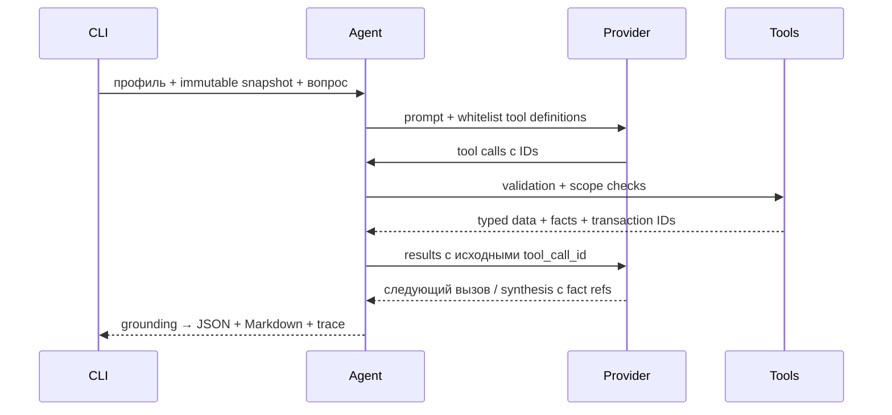

# FinTech & AI Co-Pilot

Python-бэкенд по [требованиям задания](docs/requirements.md): синтетические транзакции → детерминированные tools → многошаговый агент → JSON/Markdown для CFO.

**Offline MVP работает:** Apex Logistics — 90, CloudScale AI — 120, Harbour Trade — 150 транзакций. Четыре tools реально вызываются через dispatcher; mock моделирует ответы провайдера и получает результаты настоящих расчётов. Проверено: 67 tests, Ruff, mypy, схемы и воспроизводимость seed. Live API не запускался.

В текущем workspace `.venv` подготовлена. Проверенные команды, без ключа и сети:

```bash
.venv/bin/python -m fintech_copilot demo --company all --provider mock --seed 42 --output artifacts/demo
.venv/bin/python -m pytest -q
.venv/bin/python -m ruff check .
.venv/bin/python -m ruff format --check .
.venv/bin/python -m mypy src
.venv/bin/python scripts/check_preparation.py --schemas
```

На компанию создаются `dataset.json`, `report.json`, `report.md`, `trace.jsonl`; общий `summary.json`. Коды выхода: 0 complete, 2 configuration/input error, 3 partial. Чистая установка/wheel и Docker **не проверены** из-за ограничений окружения; инструкции и checklist — [setup](docs/setup.md), точный статус — [implementation-status](docs/implementation-status.md).



Фактическая строка **mock** trace выполненного демо (не live LLM evidence):

```json
{"run_id": "run:cc45501517134203b37c7e3599e6413e", "event_index": 2, "event": "tool_call", "timestamp": "2026-10-06T11:09:17.783974+00:00", "provider_mode": "mock", "model": null, "tool": "CalculateLiquidityRunway", "tool_call_id": "mock-0-0", "arguments": {"company_id": "cloudscale-ai", "snapshot_id": "snapshot:0786538183039778deff5b01", "period_start": "2026-07-01", "period_end": "2026-10-01"}}
```

Domain использует Decimal; Tools считает по frozen snapshot; Orchestration проверяет ссылки, predicates/actions и бюджеты. Модель выбирает finding/action codes, сервер выводит числа только из tool facts. Исходные golden ожидания сохранены.

Синтетика искусственная; cash flow не равен бухгалтерской прибыли. Нет открытых AP/AR, FX и audited accounts. Налоговый драфт — expense review schedule, `filing_ready=false`, налог не рассчитан. Live — отдельный явно включаемый платный режим; модель/ключ не нужны mock.

Kafka/EDA после MVP: идемпотентный ingestion → версионированные snapshots → события перерасчёта → deterministic read models → отчёт с конкретным snapshot. Подробнее: [архитектура](docs/architecture.md), [финансовая логика](docs/financial-logic.md), [план](docs/implementation-plan.md).
