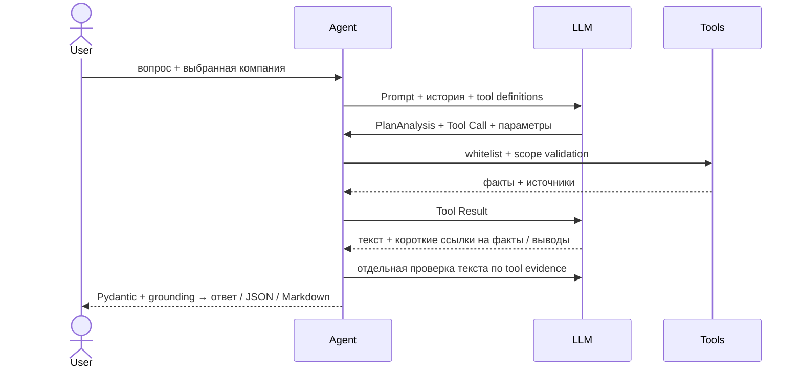

# FinTech & AI Co-Pilot

Финансовый агент для трёх синтетических компаний: Apex Logistics, CloudScale AI, Harbour Trade. **Domain** — Decimal и финансовые правила; **Tools** — whitelist, snapshot и факты с источниками; **AI Orchestration** — диалог, вызовы LLM и grounding. Pydantic v2 проверяет контракты, grounding — доказательства выводов; числа в финансовых ответах берутся из tools.

В подготовленном окружении ([установка и Gateway](docs/setup.md)):

```bash
.venv/bin/python -m fintech_copilot chat --company cloudscale-ai --provider mock --seed 42
.venv/bin/python -m fintech_copilot demo --company all --provider mock --seed 42 --output artifacts/demo
```

В чате: «Сначала расходы, потом аномалии» → «Почему?» → «Дай отчёт». Модель строит план, выполняет все пункты и пишет ответ; история и snapshot сохраняются. `--verbose` показывает параметры и диагностику. `/reset`, `/help`, `/exit`; trace и отчёты — в `artifacts/chat/`. Mock — сценарный эмулятор с настоящими tools. Для LLM экспортировать Gateway environment из своего `.env` и явно выбрать `--provider live` (платные запросы); ключи только в окружении. Подробнее: [чат](docs/chat.md), [Swagger/HTTP](docs/api.md).



Сокращённый **фактический live trace** CloudScale, `mimo-v2.6-flash`, 2026-10-06, run `767543afd580445295c28746c66ec330`. Все вызовы имели одинаковые параметры `scope`:

```text
scope = {"company_id":"cloudscale-ai","snapshot_id":"snapshot:0786538183039778deff5b01","period_start":"2026-07-01","period_end":"2026-10-01"}
CalculateLiquidityRunway(scope)   → ok
CategorizeOpex(scope)             → ok
DetectCashFlowAnomalies(scope)    → ok
DraftHKProfitsTax(scope)          → ok
LLM Synthesis → grounding accepted → complete
```

Проверено: 335 offline tests, Ruff, mypy; повторяемые mock CLI/chat, схемы и ASGI API. До последних исправлений live: три complete batch-профиля и два перепроверенных полных отчёта чата CloudScale; текущая версия проверена offline. Отдельные запросы чата могут завершаться INVALID_REPLY; чистая установка, сетевой HTTP smoke и Docker пока не подтверждены. Результаты и ограничения: [проверки](docs/validation.md).

Синтетика задаёт фиксированные месячные обороты/доли и специальные платежи; seed меняет детали. Нет сезонности, реальных контрагентов, открытых AP/AR, FX и audited accounts. Cash flow не равен прибыли; tax draft — expense review, `filing_ready=false`. Обычный разговор — текст LLM без финансовой схемы; анализ требует план и tools. Финансовый текст пишет LLM; значения вставляются по проверенным fact refs. Семантический LLM review снижает риск выдуманных объяснений, но не гарантирует их отсутствие. Чат ограничен данными выбранной компании.

Масштабирование до Kafka/EDA: идемпотентный ingestion и дедупликация → версионированные snapshots → события перерасчёта → deterministic read models → отчёты с snapshot ID; outbox/DLQ и отдельный LLM worker. Kafka не реализована; [архитектура](docs/architecture.md).
