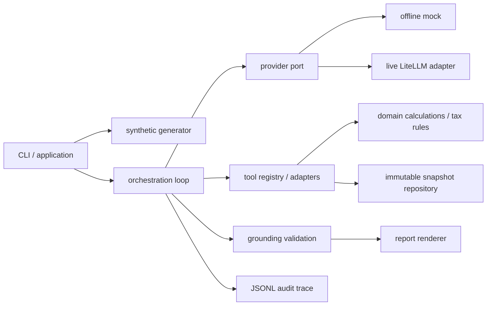

# Архитектура и границы слоёв

MVP — один процесс, in-memory snapshot и файловые артефакты. Python 3.11+, Pydantic v2, pytest, Ruff, mypy; live adapter через optional LiteLLM. Проверенные dependency closures зафиксированы в requirements-runtime/dev; чистая установка и контейнер ещё не проверены.



## Реализованная структура пакета

```text
src/fintech_copilot/
  __main__.py, cli.py       CLI и файловые артефакты
  domain/
    models.py              immutable dataset / scope / money validation
    results.py             typed financial outputs / facts / result envelopes
    generator.py           seeded transactions из server-owned scenarios
    finance.py             liquidity, cash/OPEX buckets, causal anomaly signals
    tax.py                 versioned expense review rules
  tools/
    dispatcher.py          whitelist, scope validation, cache, четыре tools
    catalogue.py           facts и derivation/evidence footprints
  orchestration/
    models.py              synthesis и report contracts
    providers.py           Provider protocol, scripted mock, optional LiteLLM
    agent.py               bounded loop, result messages, trace, partial status
    grounding.py           scope/fact/predicate/action validation
  resources/               scenarios, tool definitions, synthesis schema, prompt
  render.py                Markdown из проверенных tool facts
  py.typed
tests/                      domain, orchestration, CLI, contracts, edges, opt-in live
```

Для MVP связанные domain расчёты объединены в finance.py, provider adapters — в providers.py. Immutable Dataset передаётся dispatcher напрямую: отдельного repository/network transport нет. Domain не импортирует SDK, prompts, tools или orchestration; tools не знает модель, orchestration не пересчитывает деньги. Package resources обеспечивают независимость CLI от cwd после установки пакета (wheel install ещё предстоит проверить).

## Контракты зависимостей

Provider: `complete(messages, tool_definitions) -> ProviderTurn(tool_calls | synthesis)`; адаптер нормализует IDs и сохраняет исходные model call IDs. Snapshot context: неизменяемый `Dataset`, выбранный CLI. Tool dispatcher: `dispatch(name,args,context) -> ToolResult`. Python typing/Pydantic применяются на границах и выходах, не только на входном HTTP/CLI.

Исходные JSON Schemas фиксируют публичный v1 контракт и не переписывались. Pydantic runtime schemas экспортируются scripts/export_schemas.py; tests сравнивают наборы публичных полей/required, валидируют примеры и проверяют выходы по исходным schemas. Это проверка совместимости, а не доказательство полного равенства схем; cross-field и predicate checks выполняются runtime кодом. Сквозной `schema_version=1.0` независим от версии ruleset и SDK.

## Данные, безопасность, наблюдаемость

Только синтетика. Описания транзакций считаются недоверенным текстом и никогда не выполняются. Агент получает агрегаты/evidence, а не credentials и полный конфиг окружения. Registry имеет только четыре read-only tools. Company/snapshot проверяются по run context, лимитируется размер arguments и число вызовов. Mock не импортирует SDK провайдера.

Run metadata: seed, config/schema/ruleset version, dataset hash, prompt version, provider mode/model, run ID. Tool trace: имя, args, call/result IDs, duration, status, facts, безопасные error codes. API keys и authorization headers не журналировать. Live response может содержать недоверенный текст; не публиковать raw chain-of-thought. Для reproducibility сравнивается normalized trace без latency/IDs runtime.

Операционные retries только для transient provider ошибок с лимитом из orchestration spec. Tools работают над одним immutable snapshot; кеш по `(tool,args,snapshot hash,ruleset)` безопасен в рамках run. Изменение данных требует нового snapshot/result/fact IDs.

## Путь к Kafka / EDA (вне реализации MVP)

Ingestion принимает `transaction_id`, company/account, event time, currency и version; идемпотентно сохраняет нормализованные движения. Kafka partition key=company/account для локального порядка; дедупликация и source version позволяют избежать double-counting. Late events/corrections создают новую snapshot version и событие `MetricsRecalculationRequested`.

Worker рассчитывает deterministic read models и публикует `MetricsCalculated`; агент ссылается на конкретный snapshot, не на меняющееся состояние. Currency normalization, audit retention и access controls добавляются на ingestion/report boundaries. Outbox для надёжной публикации и DLQ для невалидных событий; не обещать exactly-once без transactional design. Запрос модели не блокирует ingestion. LLM reports versioned and idempotent по company/snapshot/question/prompt version.
