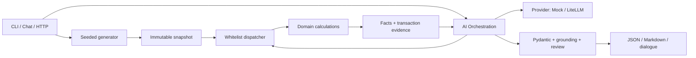

# Архитектура и контракты

Приложение работает в одном процессе с неизменяемым снимком синтетических данных. CLI, консольный чат и HTTP API используют общие финансовые инструменты. Python 3.11+, Pydantic v2; LiteLLM и FastAPI — дополнительные зависимости.

## Слои

| Слой | Ответственность |
|---|---|
| `domain/` | Dataset/Transaction, Decimal, генератор, ликвидность, расходы, аномалии и налоговые правила |
| `tools/` | Whitelist dispatcher, проверка scope, кеш и каталог фактов с источниками |
| `orchestration/` | Provider port, вызовы модели, план/цикл агента, grounding, review и сборка отчёта |
| `cli.py`, `chat_console.py`, `api.py` | Ввод, запуск сценария, вывод и HTTP transport |
| `resources/`, `render.py` | Версионированные конфигурации/промпты и отображение проверенных результатов |

Domain не импортирует SDK, промпты, Tools или Orchestration. Инструменты не зависят от модели. Orchestration не пересчитывает финансовые значения.

## Данные и инструменты

Pydantic-модели запрещают неизвестные поля; Dataset и результаты immutable. Деньги — конечный Decimal, JSON — строки с двумя знаками. Float, NaN и Infinity запрещены. Периоды полуоткрытые `[start,end)`, сортировка транзакций стабильная `(posted_on, transaction_id)`.

Генератор создаёт 90/120/150 транзакций за июль–сентябрь 2026. Seed определяет детали распределения и даты; месячные targets, доли категорий и специальные платежи задаёт серверный сценарий. Одинаковые конфигурация и seed дают одинаковый dataset и snapshot ID из хеша данных. Реалистичность ограничена этими сценариями; произвольное текстовое описание компании генератор не интерпретирует.

Четыре финансовых инструмента:

| Tool | Результат |
|---|---|
| `CalculateLiquidityRunway` | Остатки, cash gaps, burn, runway/stress, lag оплаченных счетов |
| `CategorizeOpex` | OPEX, inventory, unknown/non-OPEX, категории и доли |
| `DetectCashFlowAnomalies` | Исторические выбросы, месячные скачки, unknown cross-border review |
| `DraftHKProfitsTax` | Предварительный expense review с правилами, источниками и недостающими данными |

Аргументы каждого tool: `company_id`, `snapshot_id`, `period_start`, `period_end`. Период состоит из полных календарных месяцев внутри snapshot. Модель не задаёт деньги, ставки, thresholds или правила. Dispatcher проверяет whitelist/scope и кеширует результат внутри snapshot. Произвольных file/network/shell tools нет.

Успешный ToolResult содержит scope, стабильный result ID, typed `data`, `facts` и `warnings`. Fact содержит metric, value, unit, result/fact IDs, transaction IDs и derivation code. Значения каталога должны совпадать с `data`; агрегации сохраняют полный transaction evidence. Ошибка инструмента содержит безопасный code/message без raw exception для модели.

## Grounding и цикл агента

Batch CLI и `/reports`: модель вызывает tools через Function Calling. После четырёх успешных full-period результатов получает компактную проекцию существующих фактов и все допустимые finding/action evidence bundles. Final/repair используют API JSON mode без tools. Pydantic проверяет Synthesis, а grounding — реальные источники, scope, финансовые predicates и допустимые действия. LLM выбирает и ранжирует insights; Markdown выводит их контролируемыми шаблонами.

Чат использует планирование и выборочные вызовы: [chat.md](chat.md). Обычный разговор имеет отдельный контракт; финансовый writer выбирает fact/context parts, а сервер вставляет исходные значения. Отдельный model turn проверяет смысл пояснений. Это вероятностная проверка: корректная ссылка сама по себе не доказывает верную атрибуцию или причину.

Недостоверный synthesis не публикуется. Batch возвращает `partial` с доступными фактами и причинами; чат сообщает ошибку и сохраняет успешные расчёты. На запрос: до 8 provider turns, 12 tool calls, 90 s на попытку, 300 s deadline, одна transient retry и один repair; review чата входит в бюджет. Trace содержит run/event IDs, tool/args/status, безопасную диагностику, finish reason и token metadata; ключи и raw reasoning не сохраняются.

Report JSON содержит company/snapshot/period/seed, provider/model, `complete|partial`, причины, facts, synthesis, tax draft и tool results. CLI demo пишет dataset/report/Markdown/trace и summary; exit codes: 0 — complete, 2 — ошибка ввода/конфигурации, 3 — partial/provider failure. Runtime IDs/timestamps исключаются при сравнении воспроизводимых результатов.

Исходные [JSON Schemas](../contracts/README.md) фиксируют публичный v1 контракт. Pydantic schemas экспортируются `scripts/export_schemas.py` в `artifacts/schemas/`. Совместимость выходов и runtime-инварианты проверяются отдельно; полного тождества схем не заявляется. Формулы — в [financial-logic.md](financial-logic.md), налоговые допущения — в [tax-rules.md](tax-rules.md), проверки — в [validation.md](validation.md).

## Масштабирование до Kafka / EDA

Kafka и ingestion сейчас не реализованы. Возможное расширение: идемпотентный приём движений и дедупликация → версионированные snapshots → события перерасчёта → deterministic read models → отчёты с конкретным snapshot ID. Partition key company/account сохраняет локальный порядок; corrections/late events создают новую версию, не меняют уже выданные источники.

Outbox и DLQ поддерживают надёжную публикацию и разбор невалидных событий. Отдельный LLM worker не блокирует ingestion; результаты версионируются по company/snapshot/question/prompt. FX, хранение, доступ и аудит потребуют отдельных компонентов. Exactly-once без transactional design не предполагается.
